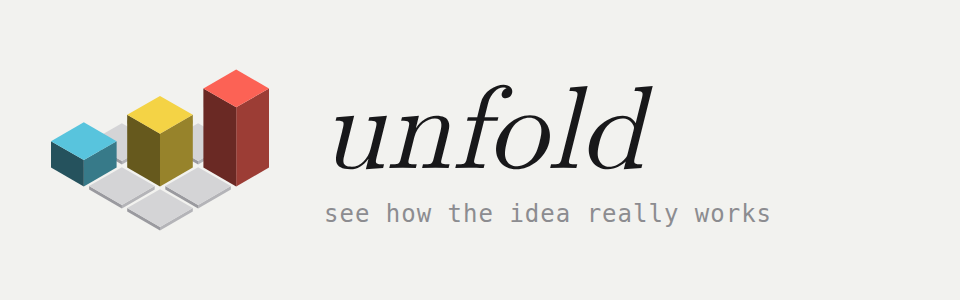
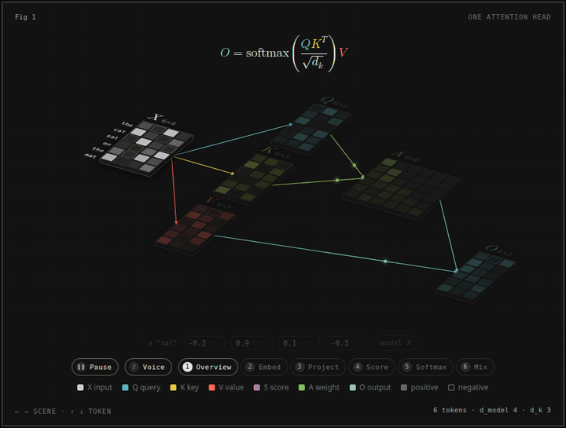

<p align="center">
  <picture>
    <source media="(prefers-color-scheme: dark)" srcset="brand/unfold-logo-dark.png">
    
  </picture>
</p>

<p align="center">
  Interactive explainer figures for software and math ideas, as a <a href="https://claude.com/claude-code">Claude Code</a> skill.
</p>

<p align="center">
  <a href="https://xafold.github.io/unfold/examples/attention-head/attention-head.html">Live demo</a> ·
  <a href="https://xafold.github.io/unfold/brand/attention-head-demo.mp4">Video with voice</a> ·
  <a href="#install">Install</a> ·
  <a href="#use">Use</a> ·
  <a href="#examples">Examples</a>
</p>

---

## See it

This is one self-attention head, made by unfold. Click the picture to open the live page. Then press **Play** to hear the narration.

<p align="center">
  <a href="https://xafold.github.io/unfold/examples/attention-head/attention-head.html">
    
  </a>
</p>

The GIF runs at 6 times normal speed and has no sound. To hear the voice, open the [live page](https://xafold.github.io/unfold/examples/attention-head/attention-head.html) or the [video with voice](https://xafold.github.io/unfold/brand/attention-head-demo.mp4) (2 minutes).

On the live page you can:

1. Press **Play** for the narrated tour of 6 scenes.
2. Use the arrow keys. Left and right change the scene. Up and down pick the word.
3. Type new numbers in the 4 fields for the word "sat". The whole head computes again.

## What unfold makes

The output is one standalone HTML page with no runtime dependencies. The style combines 3Blue1Brown and Welch Labs:

- The figure draws the real structure of the idea (vectors, matrices, trees, graphs, timelines). It does not use a machine metaphor.
- Every number on screen comes from a small truth model (`model.mjs`) with asserts. You can check the numbers by hand.
- Each concept has one colour, everywhere in the figure. A figure picks its colours from the 7 hues below.
- Math is shown in MathML next to the shapes.
- Scenes morph from the big picture down to single values.
- The reader does the operation (insert, search, step, send, match) on their own input.
- Each scene can have a recorded voice, and the figure lights the part that the voice talks about.

## Install

You need Claude Code 2.1.275 or later. In Claude Code, run:

```text
/plugin install unfold --marketplace xafold/unfold
```

With an older Claude Code, use two commands:

```text
/plugin marketplace add xafold/unfold
```

```text
/plugin install unfold@unfold
```

Then restart Claude Code, or run `/reload-plugins`. When it works, `/plugin` lists `unfold` as enabled.

The plugin contains everything the skill needs. You do not install another skill.

To build and check figures, you also need on your computer:

- Node.js 20.10 or later
- Google Chrome or Chromium, for the screenshot checks
- ffmpeg, only to record a demo video (`scripts/record.mjs`)

There is no `package.json` and nothing to `npm install`.

To get a new version later, run this in your shell, then restart Claude Code:

```bash
claude plugin update unfold@unfold
```

## Use

Ask Claude Code for a figure in plain words. The skill starts by itself when the request fits:

```text
Make me an interactive explainer of gradient descent for my ML course notes.
Use a 1-D loss and show a learning rate that is too small, about right and too big.
```

```text
explain git rebase vs merge visually for our team wiki. show the commit graph changing.
```

You can also call the skill by name. A plugin skill has the plugin name in front:

```text
/unfold:unfold B-tree insert
```

```text
/unfold:unfold --no-voice how git rebase rewrites commits
```

### Options

| Option | Result |
|---|---|
| `--voice` (default) | Claude writes a narration script (`script.md`). You approve it. Then each scene is recorded with a text-to-speech provider, and the figure follows the voice. |
| `--no-voice` | No narration. Each scene gets a short text in the card instead. "no audio" or "text only" in the request means the same thing. |

### Voice providers

With `--voice`, Claude asks which provider to use. Set the key in your shell profile before you start Claude Code. Do not paste a key into the chat.

| Provider | Key | Default voice |
|---|---|---|
| Gemini | `GEMINI_API_KEY` | `Kore` |
| OpenAI | `OPENAI_API_KEY` | `coral` |
| ElevenLabs | `ELEVENLABS_API_KEY` | George |

With no key, the page uses the browser's built-in voice. The clips are saved as MP3 files next to the page, so a rebuild needs no key.

### What Claude does

1. Finds the shape of the concept (structure, process, sequence in time, transform of numbers, and so on).
2. Writes `model.mjs`: the real computation, with asserts.
3. Writes `build.mjs`: the scenes, built with `kit/concept-kit.mjs`.
4. Builds a dark page and a light page.
5. Takes screenshots of every scene in dark, light, 390 px and reduced motion, and reads them.
6. Checks the text budget of the page.

## Examples

Each folder in `examples/` has the truth model, the build script and the built pages. Each example has a dark page (`<name>.html`) and a light page (`<name>-light.html`).

| Example | What the reader does | Scenes |
|---|---|---|
| [`attention-head`](https://xafold.github.io/unfold/examples/attention-head/attention-head.html) | Edits one row of X and sees the whole self-attention head compute again | 6 |
| [`btree-insert`](https://xafold.github.io/unfold/examples/btree-insert/btree-insert.html) | Picks a key and follows the search path, and watches splits and promotions | 7 |
| [`event-loop`](https://xafold.github.io/unfold/examples/event-loop/event-loop.html) | Steps through the JavaScript event loop that prints A D C B | 5 |
| [`function-call`](https://xafold.github.io/unfold/examples/function-call/function-call.html) | Compares one call in six languages: frames, bytecode, stack depth | 7 |
| [`dijkstra`](https://xafold.github.io/unfold/examples/dijkstra/dijkstra.html) | Clicks a source node, edits edge weights, and runs Dijkstra again | 6 |
| [`backprop`](https://xafold.github.io/unfold/examples/backprop/backprop.html) | Takes gradient steps on a 2-2-1 network and watches the loss | 7 |
| [`tcp-handshake`](https://xafold.github.io/unfold/examples/tcp-handshake/tcp-handshake.html) | Types the ISNs and the payload, and every seq and ack number follows | 7 |
| [`regex-nfa`](https://xafold.github.io/unfold/examples/regex-nfa/regex-nfa.html) | Types an input string and steps the Thompson NFA for `a(b\|c)*d` | 6 |
| [`google-search`](https://xafold.github.io/unfold/examples/google-search/google-search.html) | Follows a query through crawl, inverted index, BM25 and PageRank on 6 pages | - |

## Build an example by hand

Run these commands from an example folder, for example `examples/dijkstra/`:

```bash
node model.mjs
```

```bash
node build.mjs
```

```bash
node build.mjs --light
```

```bash
node ../../scripts/shoot.mjs dijkstra.html --scenes 6 --out /tmp/dijkstra-shots
```

```bash
node ../../scripts/words.mjs dijkstra.html
```

What each command does:

1. `node model.mjs` runs the truth model asserts. It prints `model ok`.
2. `node build.mjs` writes the dark page. `node build.mjs --artifact <path>` writes a page for a claude.ai Artifact instead.
3. `node build.mjs --light` writes the light page.
4. `shoot.mjs` captures every scene. It fails on console errors, sideways scroll, overlapping text, or an equation that is too wide.
5. `words.mjs` checks the reader text against its budget. It prints `words ok`.

To record a demo like the one above, run this from the example folder:

```bash
node ../../scripts/record.mjs attention-head.html --out /tmp/attention-head-demo
```

It writes an MP4 with the voice and a fast GIF without sound.

Some models check against real tools. `function-call` runs python3, node, ruby, gcc, java and rustc. `dijkstra` checks against networkx when it is installed. A missing tool is skipped with a message.

## Benchmarks

Each benchmark gives the same prompt to a builder with unfold and to a builder without it. A Gemini judge scores both pages blind, with the order swapped. Highlights:

| Prompt | unfold /80 | Baseline /80 |
|---|---|---|
| Regex NFA | 78.50 | 38.00 |
| Dijkstra | 79.00 | 62.00 |
| TCP handshake | 77.75 | 58.75 |
| Function call in all languages | 77.75 | 63.50 |

Not every test is a win. Fourier and DNS lost. The full table, with the losses, is in [`benchmarks/README.md`](benchmarks/README.md).

## Known limits

- At 390 px, small text that the figure draws is hard to read. `attention-head`, `btree-insert` and `event-loop` do not have a narrow phone layout yet.
- `regex-nfa` takes your input string, but not your own pattern.
- The event-loop simulator supports only one 0 ms timer, and it does not model rendering.
- Stack depths in `function-call` were measured on Linux x86-64. On another machine, measure them again.

## Credits

unfold was inspired by the [anatomy](https://github.com/wheresryan22/anatomy) skill by Ryan. Its card, iso camera and Chrome driver are adapted from anatomy, under the MIT License. [THIRD_PARTY_NOTICES.md](THIRD_PARTY_NOTICES.md) lists the files.

## License

MIT. See [LICENSE](LICENSE).
